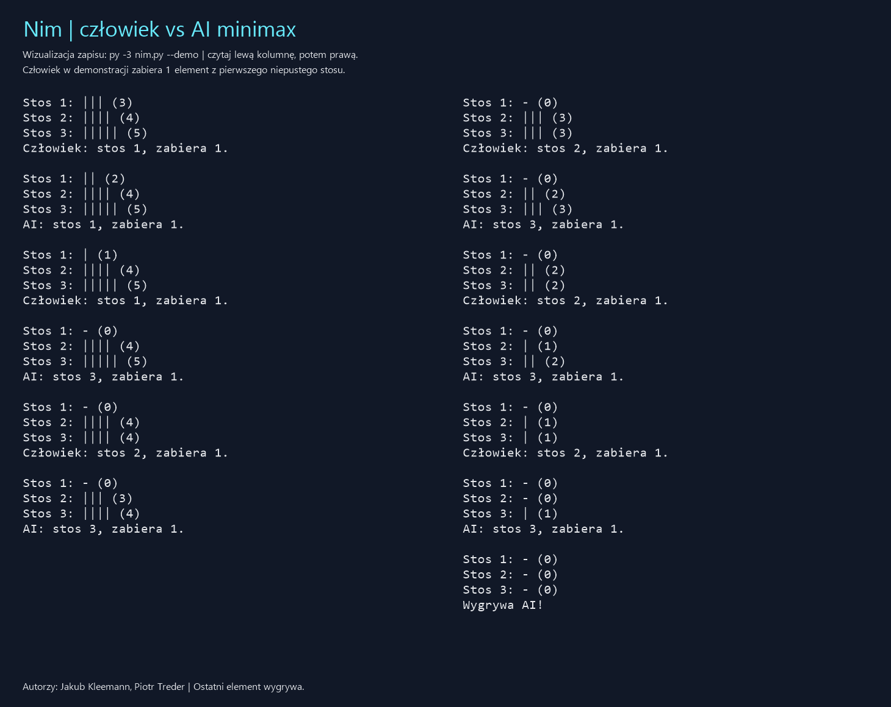

# Nim — Zadanie 01: Gra

Autorzy: **Jakub Kleemann, Piotr Treder**.

Turowa, deterministyczna gra dwuosobowa o sumie zerowej w Pythonie.
Człowiek gra przeciwko AI wykorzystującej **minimax** (adversarial search).

## Zasady

[Zasady klasycznego Nim — Wolfram MathWorld](https://mathworld.wolfram.com/Nim.html).
Gracze na zmianę zabierają dowolną dodatnią liczbę elementów z dokładnie
jednego stosu. **Wygrywa gracz zabierający ostatni element**. Domyślne stosy:
3, 4, 5. Wszystkie stosy są widoczne, nie ma losowości ani remisów.
Nie stosujemy wariantu misère.

## Przygotowanie i uruchomienie

Python **3.10 lub nowszy**, tylko biblioteka standardowa, bez dodatkowych pakietów.
W katalogu repozytorium na Windows:

```powershell
py -3 nim.py
py -3 nim.py --piles 2 3 4 --first ai
py -3 nim.py --demo
py -3 -m unittest discover -s tests -v
```

Na Linux/macOS zastąp `py -3` poleceniem `python3`.
Ruch to **numer stosu i liczba elementów**, np. `2 3`; numeracja zaczyna się
od 1. Puste stosy zachowują numer. `q` kończy grę. Błędny ruch nie zmienia
planszy ani nie kończy tury. `--demo` pokazuje powtarzalną partię bez
wprowadzania danych; człowiek zawsze zabiera jeden element z pierwszego
niepustego stosu. Można zmieniać gracza rozpoczynającego (`human` lub `ai`).
Dla sprawnego pełnego przeszukiwania konfiguracja początkowa jest ograniczona
do 1–4 stosów po 1–7 elementów.

## AI: minimax

Stan jest niemutowalną krotką liczebności stosów. Generator tworzy wszystkie
legalne ruchy. Minimax analizuje drzewo **aż do końca**, bez heurystyki
i limitu głębokości. Wartości z perspektywy AI: zwycięstwo `+1`, porażka `-1`.
Pusta plansza oznacza porażkę gracza, którego tura miałaby nastąpić.
AI maksymalizuje ocenę, człowiek minimalizuje. `lru_cache` zapamiętuje
dokładne wyniki dla par `(stan, czy tura AI)`; powtarzające się pozycje
nie wymagają ponownego rozwijania drzewa. Przy równych ocenach wybierany
jest pierwszy ruch: rosnący numer stosu, potem liczba elementów.

AI nie używa wzoru XOR do wyboru ruchu. XOR występuje wyłącznie w testach
jako niezależny wzorzec sprawdzający minimax dla 124 niepustych pozycji.
AI gra optymalnie, ale z pozycji przegrywającej nie może wymusić zwycięstwa
przeciwko optymalnie grającemu człowiekowi.

## Demonstracja

Zapis `--demo`: [docs/przykladowa-rozgrywka.txt](docs/przykladowa-rozgrywka.txt).
Podgląd: [wersja HTML](docs/przykladowa-rozgrywka.html).



Obraz jest wizualizacją rzeczywistego wyjścia programu, nie zrzutem terminala.
Aby spełnić wymaganie zrzutu ekranu, uruchom `py -3 nim.py --demo`, wykonaj
zrzut terminala (np. `Win+Shift+S`) i zapisz go w `docs/zrzut-rozgrywki.png`.

Podczas prezentacji pokaż poprawny i błędny ruch, zwycięstwo po zabraniu
ostatniego elementu, zmianę gracza rozpoczynającego oraz funkcje
`minimax` i `choose_ai_move`. Testy sprawdzają reguły, końce partii i AI.

## Czynności organizacyjne

- Uzgodnić z grupą, czy nikt nie wybrał tej samej gry i technologii.
- Przesłać link do repozytorium lub nadać dostęp prowadzącemu:
  `pczapiewski@pjwstk.edu.pl` (adres z treści zadania).
- Przygotować się do demonstracji i wyjaśnienia minimax.
