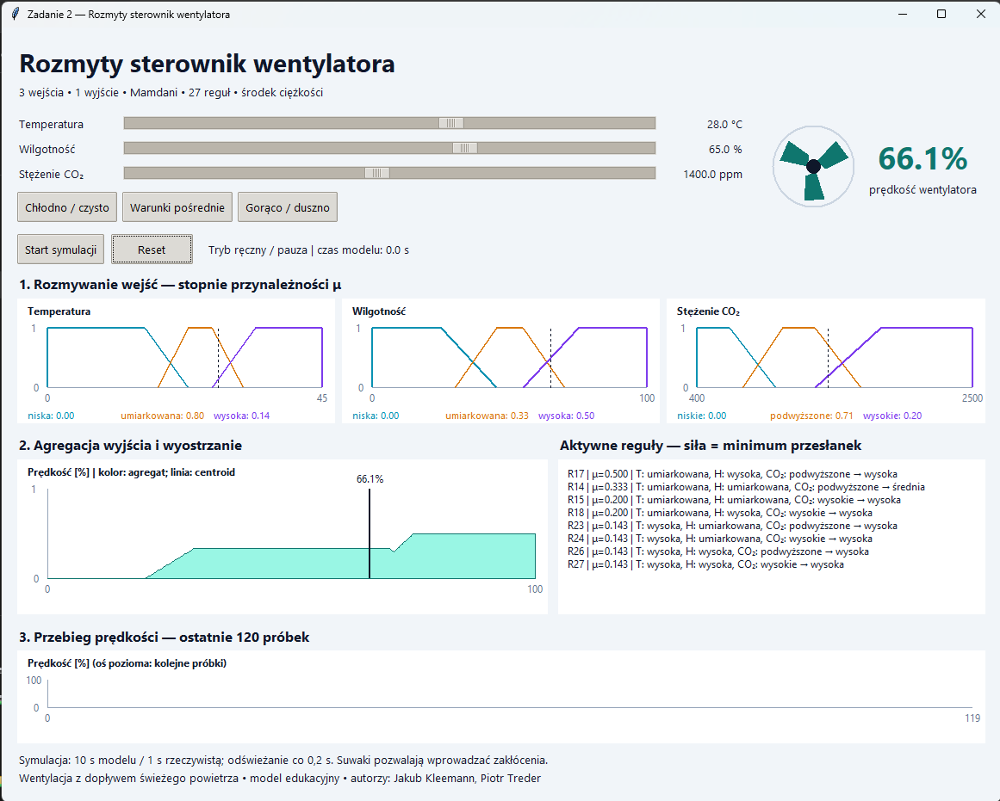

# Zadanie 02 — Rozmyty sterownik wentylatora

**Autorzy: Jakub Kleemann, Piotr Treder.**

Problem: automatyczny dobór prędkości wentylatora wywiewnego na podstawie
temperatury, wilgotności względnej i jakości powietrza reprezentowanej
przez stężenie CO₂. Rozwiązanie: **Python, logika rozmyta Mamdaniego**,
trzy wejścia, jedno wyjście i pełna baza 27 reguł.

## Uruchomienie

Wymagany **Python 3.10 lub nowszy z Tkinter**. Nie ma pakietów do instalowania
przez `pip`. Na Windows Tkinter jest składnikiem oficjalnego instalatora
Pythona („tcl/tk and IDLE”). Na Linux może być potrzebny pakiet systemowy
`python3-tk`; na macOS można użyć instalatora Pythona zawierającego Tk.

W katalogu głównym repozytorium, w PowerShell:

```powershell
cd "zad 2"
py -3 app.py
```

Na Linux/macOS polecenie uruchomienia to `python3 app.py`.
Tryby bez okna nie wymagają Tkinter:

```powershell
# Jednorazowe obliczenie: temperatura [°C], wilgotność [%], CO₂ [ppm]
py -3 app.py --cli 28 65 1400

# Powtarzalna demonstracja 120 sekund modelu z zapisem danych
py -3 app.py --demo --duration 120 --csv docs/demo.csv

# Testy (uruchamiane z katalogu zad 2)
py -3 -m unittest discover -s tests -v
```

## Obsługa i demonstracja w czasie rzeczywistym

1. Zmieniaj trzy suwaki. Obroty, wykresy i siły reguł aktualizują się od razu.
2. Porównaj gotowe scenariusze: „Chłodno / czysto”, „Warunki pośrednie”,
   „Gorąco / duszno”. Scenariusz zatrzymuje symulację i zeruje historię.
3. Wybierz „Gorąco / duszno”, następnie „Start symulacji”. Sterownik wpływa
   na model pomieszczenia, a jego nowe pomiary wracają na wejścia sterownika.
4. Obserwuj spadek temperatury, wilgotności i CO₂ oraz reakcję obrotów.
   Przesuń dowolny suwak podczas symulacji, aby wprowadzić zakłócenie.
5. „Pauza” zatrzymuje czas modelu; ponowne kliknięcie wznawia symulację.
   „Reset” przywraca wartości 28 °C, 65%, 1400 ppm i zeruje historię.

GUI działa z odświeżaniem co około **0,2 s**. Jedna sekunda rzeczywista
odpowiada **10 sekundom modelu**, aby zmiany były widoczne podczas prezentacji.
Animowany wirnik obrazuje względne obroty; nie reprezentuje rzeczywistych RPM.
Historia mieści ostatnie 120 próbek, z osią poziomą oznaczającą numer próbki.
W trybie ręcznym próbka powstaje po zmianie wejścia, w symulacji co odświeżenie.

## Wejścia i wyjście

| Zmienna | Zakres | Zbiory lingwistyczne |
|---|---|---|
| Temperatura | 0–45 °C | niska, umiarkowana, wysoka |
| Wilgotność względna | 0–100% | niska, umiarkowana, wysoka |
| Stężenie CO₂ | 400–2500 ppm | niskie, podwyższone, wysokie |
| Prędkość wentylatora — wyjście | 0–100% | niska, średnia, wysoka |

CO₂ jest tu wskaźnikiem potrzeby wymiany powietrza w pomieszczeniu;
nie opisuje pyłów PM2.5, zapachów ani wszystkich składników jakości powietrza.
Zakresy i progi dobrano do demonstracji algorytmu, nie jako normy sanitarne.

## Funkcje przynależności

Każdy zbiór jest trapezem `(a, b, c, d)`: przynależność rośnie liniowo
od 0 do 1 między `a` i `b`, wynosi 1 między `b` i `c`, następnie maleje
do 0 między `c` i `d`. Poza trapezem wynosi 0.
`a=b` lub `c=d` oznacza ramię obejmujące kraniec zakresu;
`b=c` tworzy trójkąt. Implementacja poprawnie obsługuje te przypadki.

| Zmienna | Niski zbiór | Pośredni zbiór | Wysoki zbiór |
|---|---|---|---|
| Temperatura | `(0,0,16,23)` | `(18,23,27,32)` | `(27,34,45,45)` |
| Wilgotność | `(0,0,25,45)` | `(30,45,55,70)` | `(55,75,100,100)` |
| CO₂ | `(400,400,650,1000)` | `(750,1050,1300,1650)` | `(1300,1800,2500,2500)` |
| Prędkość | `(0,0,15,35)` | `(20,50,50,80)` | `(65,85,100,100)` |

Wyostrzanie środkiem ciężkości sprawia, że pełna aktywacja zbioru „niska”
daje około **13,17%**, „średnia” **50%**, a „wysoka” **86,83%**.
Przynależność do zbioru „wysoka” nie oznacza automatycznie wyjścia 100%.

## Baza 27 reguł

Każda reguła łączy trzy przesłanki operatorem **ORAZ**.
Zbiory wejść mają poziomy 0, 1, 2. Dla każdej kombinacji wybierany jest
zbiór wyjściowy o poziomie równym największemu poziomowi przesłanek.
Oznacza to, że największa potrzeba wentylacji decyduje o konsekwencji reguły.
Dotyczy to etykiet reguł, nie bezpośredniego obliczenia prędkości.

Poniższe trzy tabele obejmują wszystkie 27 reguł.

**CO₂ niskie:**

| Temperatura / wilgotność | niska | umiarkowana | wysoka |
|---|---|---|---|
| niska | niska | średnia | wysoka |
| umiarkowana | średnia | średnia | wysoka |
| wysoka | wysoka | wysoka | wysoka |

**CO₂ podwyższone:**

| Temperatura / wilgotność | niska | umiarkowana | wysoka |
|---|---|---|---|
| niska | średnia | średnia | wysoka |
| umiarkowana | średnia | średnia | wysoka |
| wysoka | wysoka | wysoka | wysoka |

**CO₂ wysokie:**

| Temperatura / wilgotność | niska | umiarkowana | wysoka |
|---|---|---|---|
| niska | wysoka | wysoka | wysoka |
| umiarkowana | wysoka | wysoka | wysoka |
| wysoka | wysoka | wysoka | wysoka |

## Proces wnioskowania

1. **Rozmywanie:** obliczenie przynależności pomiarów do trzech zbiorów każdego wejścia.
2. **Ocena reguł:** siła reguły `α = min(μT, μH, μCO₂)`.
3. **Implikacja:** obcięcie zbioru wyjściowego na wysokości `α`, operatorem `min`.
4. **Agregacja:** połączenie wyjść wszystkich reguł operatorem `max`.
5. **Wyostrzanie:** centroid `v = ∫ x·μ(x) dx / ∫ μ(x) dx`.

Całki są przybliżane metodą trapezów na 401 punktach, co 0,25 punktu procentowego.
Pełna baza pokrywa zakresy wejść. Dane spoza zakresu, NaN i nieskończoności
są odrzucane, zamiast być bezgłośnie zamieniane na poprawne pomiary.

Dla **28 °C, 65%, 1400 ppm** jednocześnie działa osiem reguł, a wynik to
**66,09%**. Pozwala to pokazać płynne rozmyte wnioskowanie zamiast samego
przełączania między trzema sztywnymi prędkościami.

Opis metody: [proces wnioskowania Mamdaniego — MathWorks](https://www.mathworks.com/help/fuzzy/fuzzy-inference-process.html),
[wyostrzanie metodą centroidu — MathWorks](https://www.mathworks.com/help/fuzzy/defuzzification-methods.html).

## Model pomieszczenia

Symulacja jest **pętlą zamkniętą**, a nie odtwarzaniem gotowych wejść:

```text
pomiary T, H, CO₂ → sterownik rozmyty → obroty → model pomieszczenia
       ↑                                            │
       └──────────────── nowe pomiary ──────────────┘
```

Zakładamy dopływ powietrza o 18 °C, wilgotności 40% i CO₂ 420 ppm oraz
stałe źródła ciepła, wilgoci i CO₂. Dla `u = obroty / 100`:

```text
k = 0,002 + 0,025·u                  [1/s]
dT/dt = 0,045 + k·(18 − T)           [°C/s]
dH/dt = 0,08  + k·(40 − H)           [punktów procentowych/s]
dC/dt = 8     + k·(420 − C)          [ppm/s]
```

Całkowanie: metoda Eulera, podkrok do 0,2 s modelu. Model ogranicza
wartości do dziedzin sterownika. Współczynniki dobrano dla czytelnej,
przyspieszonej demonstracji. Wilgotność jest modelowana bezpośrednio
jako wielkość względna — nie jest to pełny model termodynamiczny.
Wentylator musi wymieniać powietrze; zwykły wiatrak cyrkulacyjny nie usuwa CO₂.

Powtarzalny przebieg z `--demo` zaczyna się od 30 °C, 75%, 1800 ppm.
Po 120 s modelu otrzymujemy około 22,27 °C, 49,56%, 1069,49 ppm;
sterowanie zmienia się z 84,54% do 50%.
Dane: [docs/demo.csv](docs/demo.csv). GUI zaczyna od scenariusza
pośredniego 28 °C, 65%, 1400 ppm, dlatego jego przebieg zależy od wybranego
scenariusza, momentu przesunięcia suwaków i rzeczywistych odstępów odświeżania.

## Pliki i sprawdzenie rozwiązania

| Plik | Rola |
|---|---|
| `fuzzy.py` | Trapezy, definicje zmiennych, 27 reguł, inferencja Mamdaniego |
| `simulation.py` | Model pomieszczenia i powtarzalna trajektoria |
| `app.py` | GUI Tkinter, animacja, wykresy, CLI i eksport CSV |
| `tests/test_controller.py` | 11 testów reguł, centroidów, CLI i symulacji |
| `docs/demo.csv` | 121 próbek demonstracji w pętli zamkniętej |

Testy obejmują m.in. porównanie centroidów z wynikami analitycznymi,
pokrycie dziedzin w **1210 punktach**, wpływ każdego wejścia, osiem
jednocześnie aktywnych reguł oraz wpływ wentylatora na pomieszczenie.

## Wymagania zadania

- Trzy wejścia i jedno wyjście: zaimplementowane.
- Logika rozmyta: jawne zbiory, 27 reguł i inferencja Mamdaniego.
- Praca w parze: Jakub Kleemann i Piotr Treder.
- Dokumentacja: docstringi, opis problemu i autorzy na początku kodu.
- Przygotowanie środowiska: instrukcje powyżej, bez pakietów zewnętrznych.
- Demonstracja w czasie rzeczywistym: GUI z modelem w pętli zamkniętej.
- Repozytorium z poprzednich ćwiczeń: osobny katalog `zad 2` obok `zad 1`.
- Zrzut przykładowego wywołania: [docs/sterownik.png](docs/sterownik.png).
- Unikalność problemu i technologii: do potwierdzenia przez autorów w grupie.

## Zrzut działającego programu

Rzeczywisty zrzut okna Tkinter dla wejść 28 °C, 65%, 1400 ppm
(obroty 66,09%, osiem aktywnych reguł):



[Drugi zrzut — stan po działaniu symulacji](docs/symulacja.png).
