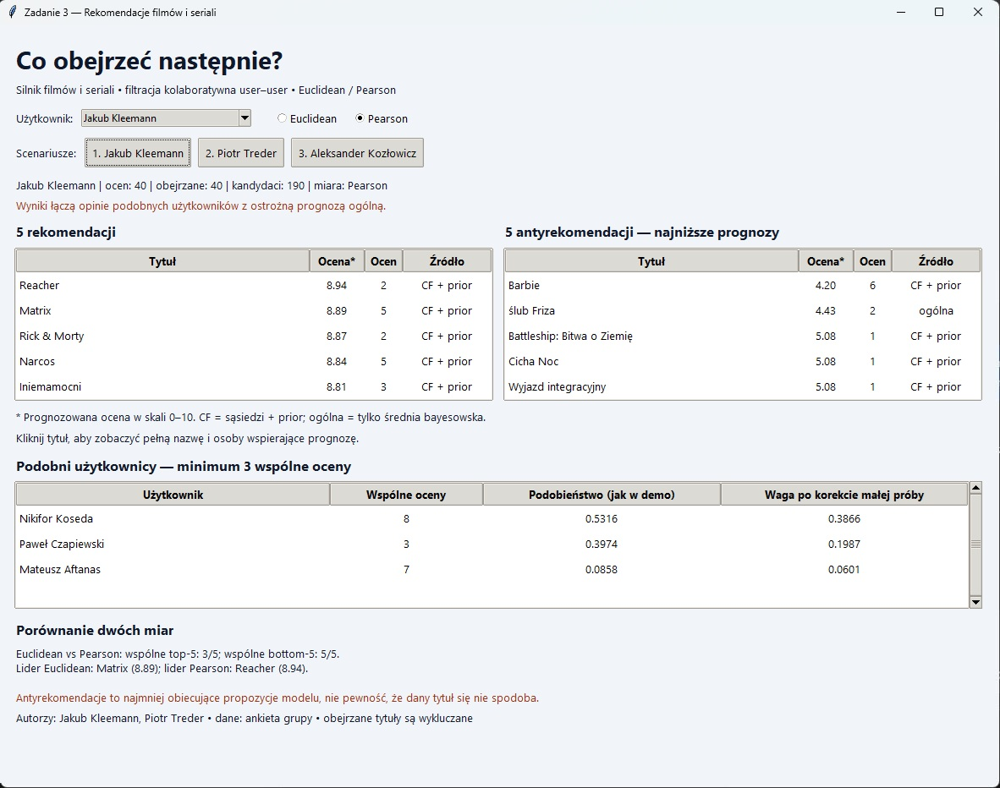
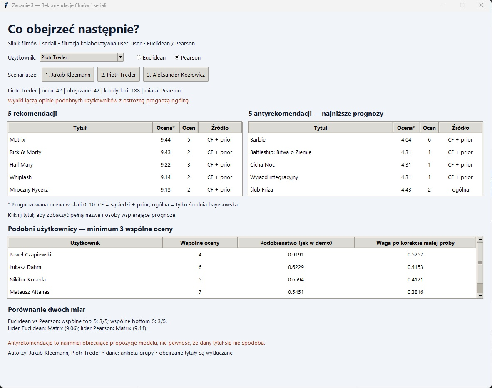
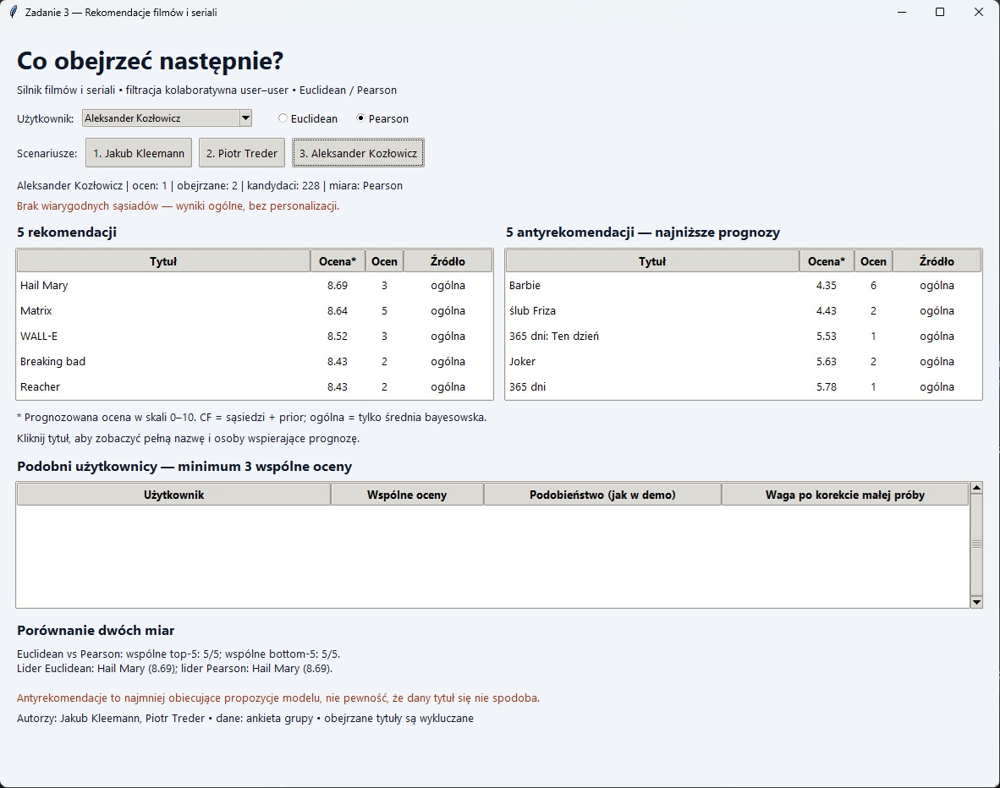

# Zadanie 03 — Silnik rekomendacji filmów i seriali

**Autorzy: Jakub Kleemann, Piotr Treder.**

Problem: na podstawie ankiety grupy wybrać dla użytkownika **5 interesujących
nieobejrzanych tytułów oraz 5 antyrekomendacji**. Program wykorzystuje
filtrację kolaboratywną user–user i porównuje **Euclidean oraz Pearson**, zgodnie
z dostarczonym przykładem prowadzącego. Ma GUI Tkinter oraz tryb konsolowy.

## Środowisko i start

Python **3.10 lub nowszy**. Wyłącznie biblioteka standardowa — bez `pip install`.
GUI wymaga Tkinter (Windows: opcja „tcl/tk and IDLE” w instalatorze Pythona;
Linux: pakiet systemowy `python3-tk`). Konsola nie wymaga Tkinter.

Z katalogu głównego repozytorium, PowerShell:

```powershell
cd "zad 3"
py -3 app.py
```

Na Linux/macOS zastąp `py -3` przez `python3`.

```powershell
# Rekomendacje i antyrekomendacje w konsoli
py -3 app.py --user "Jakub Kleemann" --metric Pearson

# Pełne porównanie obu miar
py -3 app.py --user "Piotr Treder" --compare

# Podobieństwo dwóch osób, jak w dostarczonym demo
py -3 app.py --pair "Jakub Kleemann" "Piotr Treder" --metric Euclidean

# Zapis trzech scenariuszy dla obu miar
py -3 app.py --demo

# Odtworzenie danych z oryginalnej ankiety
py -3 prepare_data.py

# Walidacja predykcji obu miar i prognozy ogólnej
py -3 evaluate.py

# Testy
py -3 -m unittest discover -s tests -v
```

Ścieżki danych są liczone względem modułów, więc aplikację można również
uruchomić z innego katalogu, podając pełną ścieżkę do `app.py`.

## Dane i ich przygotowanie

Źródło: ankieta dostarczona do zadania. Jej **oryginalna treść** jest zachowana
w [data/source.tsv](data/source.tsv). Nie dopisywano ocen ani nowych osób.

| Właściwość | Wartość |
|---|---:|
| Osoby | 13 |
| Ujednolicone tytuły | 230 |
| Oceny w źródle | 363 |
| Unikalne oceny osoba–tytuł po uśrednieniu duplikatów | 360 |
| Wpisane oceny 0 | 3 |
| Obejrzany tytuł bez oceny | 1 |

Zasady importu:

- Usuwanie nadmiarowych spacji; porównywanie nazw bez różnic wielkości liter,
  diakrytyki i interpunkcji. Wyświetlane nazwy zachowują polskie znaki.
- Jawne, edytowalne [aliasy](data/aliases.json), np. `The Matrix → Matrix`,
  `La Casa De Papel → Dom z papieru`, `Dune 1 → Diuna` oraz oczywiste literówki.
  Nie stosujemy automatycznego przybliżonego dopasowania wszystkich nazw.
- Sprzeczne powtórzenia są uśredniane: Jakub / Forrest Gump `6 i 10 → 8`,
  Miłosz / Gra o tron `2 i 4 → 3`, Miłosz / Lśnienie `9 i 10 → 9,5`.
- Brak oceny to **brak danych**, nigdy sztuczne zero. `Pulp Fiction` u Aleksandra
  pozostaje obejrzane i jest wykluczane z rekomendacji mimo braku oceny.
- Skala wynosi **0–10**, ponieważ źródło rzeczywiście zawiera oceny 0.
- Numeryczne tytuły `1670` i `2012` pozostają tytułami.
- Niejednoznaczne wpisy, np. `Harry Potter`, `Batman`, `Maze Runner` i `Legenda`,
  pozostają wpisami ankiety; nie przypisujemy im arbitralnie konkretnej części,
  roku ani identyfikatora zewnętrznej bazy. Różne części nie są łączone.

Pliki wynikowe: [ratings.csv](data/ratings.csv),
[raport czyszczenia](data/cleaning_report.json) oraz
[ratings.json](data/ratings.json) w formacie zgodnym z demo prowadzącego.
CSV jest źródłem aplikacji; JSON zawiera wyłącznie wystawione oceny,
więc samodzielnie nie przechowuje informacji o obejrzanym filmie bez oceny.

## Analiza dostarczonego demo

Demo oblicza podobieństwo dwóch użytkowników na **przecięciu ocenionych
tytułów**, korzystając z Euclidean albo Pearson. Samo nie przewiduje ocen
nieobejrzanych filmów i nie buduje rekomendacji. Rozwiązanie zachowuje wzory
demo, zastępując NumPy biblioteką standardową, oraz dodaje pełny ranking.

Dla wspólnych tytułów `C`:

```text
d(u,v) = sqrt(sum((r_ui - r_vi)^2))
s_E(u,v) = 1 / (1 + d(u,v))

s_P(u,v) = sum((r_ui - mean_u_C) * (r_vi - mean_v_C))
           / sqrt(sum((r_ui - mean_u_C)^2) * sum((r_vi - mean_v_C)^2))
```

Euclidean porównuje bezwzględne oceny. Pearson porównuje ich wzorzec,
odejmując średnie na wspólnych tytułach. Brak wspólnych ocen daje 0;
zerowa wariancja dla Pearsona również daje 0. Nieznany użytkownik zgłasza błąd.
Wynik `s_E` jest podobieństwem przekształconym z odległości, a `s_P` korelacją,
nie odległością. Zgodnie z demo porównujemy te dwie miary podobieństwa.

Referencja wzoru: [odległość euklidesowa — scikit-learn](https://scikit-learn.org/stable/modules/generated/sklearn.metrics.pairwise.euclidean_distances.html).

## Od podobieństwa do 5 + 5 propozycji

1. Kandydatami są wyłącznie tytuły mające ocenę w grupie, których użytkownik
   nie wymienił jako obejrzane. Przyszłe obejrzenie tytułu nie jest znane systemowi.
2. Wybieramy dodatnio podobnych sąsiadów z minimum **3 wspólnymi ocenami**.
   Surowy wynik z demo korygujemy wagą `w = s · n/(n+3)`.
   Ujemnej korelacji nie zamieniamy na dodatnie podobieństwo.
3. Dla każdego filmu wykorzystujemy do **5 najwyżej ważonych sąsiadów,
   którzy faktycznie go ocenili**. Sąsiedzi filmu mogą być inni dla różnych tytułów.
4. Przewidujemy ocenę i sortujemy kandydatów. Pięć najwyższych wyników to
   rekomendacje; pięć najniższych to antyrekomendacje. Listy są rozłączne.
   Przy remisach kolejność ustala tytuł. Przy mniej niż 10 kandydatach
   program zgłasza błąd, zamiast powtarzać pozycje.

### Prognoza oceny i małe próby

Niech `μ` oznacza średnią wszystkich wystawionych ocen, `m_i` liczbę ocen filmu,
`μ_u` średnią wszystkich ocen użytkownika, a `V` sąsiadów oceniających film:

```text
prior_i = (suma ocen filmu + 3*μ) / (m_i + 3)
W = suma wag sąsiadów filmu
CF_ui = μ_u + suma(w_uv * (r_vi - μ_v)) / W
prognoza_ui = (W * CF_ui + prior_i) / (W + 1)
```

Wynik ograniczamy do skali 0–10. Przy `W=0` stosujemy wyłącznie `prior_i`,
oznaczony w GUI jako **„ogólna”**. Dzięki temu pojedyncze 10/10 nie wystarcza,
aby bez zastrzeżeń ogłosić film idealnym dla wszystkich.
To średnia wygładzona trzema pseudoocenami równymi średniej grupy,
a nie procentowa pewność ani prawdopodobieństwo polubienia filmu.

GUI pokazuje liczbę ocen filmu, źródło prognozy oraz sąsiadów i ich wagi.
Kliknięcie tytułu wyświetla jego pełną nazwę i osoby wspierające predykcję.
Bez wiarygodnych sąsiadów pojawia się jawna informacja o braku personalizacji.
Antyrekomendacje oznaczają **najniższe prognozy modelu**, nie pewność niechęci.
Przy tak małej, rzadkiej ankiecie wiele propozycji ma słabe wsparcie.

## Porównanie z artykułem o klasteryzacji

Przeanalizowano wskazany artykuł
[Ishika Chatterjee — A Comparative Study of Clustering Algorithms](https://medium.com/analytics-vidhya/comparative-study-of-the-clustering-algorithms-54d1ed9ea732).
Omawia K-means, klasteryzację hierarchiczną, SOM i modele mieszanin/EM.
Wniosek projektowy: wybór reprezentacji, odległości i charakteru danych
ma znaczenie dla grupowania podobnych obiektów. Klasteryzacja hierarchiczna
pozwala dobrać sposób łączenia grup; K-means wymaga ustalenia liczby klastrów.

W tym zadaniu stosujemy **sąsiedztwo użytkowników, nie K-means**: ankieta jest
mała i niepełna, a wypełnienie wszystkich braków zerami tworzyłoby fałszywe
oceny. Miary liczymy tylko na wspólnych tytułach. Polecenie wymaga silnika
rekomendacji, nie narzuca konkretnego algorytmu klasteryzacji.

## Porównanie jakości predykcji

[evaluate.py](evaluate.py) wykonuje **leave-one-out**: usuwa jedną ocenę,
następnie od nowa wyznacza średnie, podobieństwa i prognozę. Odłożona ocena
nie trafia do statystyk treningowych. Porównujemy obie miary i sam prior
na tych samych 216 obserwacjach; 144 oceny pomijamy, ponieważ po ich odłożeniu
film nie ma żadnej innej oceny w zbiorze treningowym.

| Model | MAE | RMSE | Prognozy wsparte sąsiadami / 216 |
|---|---:|---:|---:|
| Euclidean | 1,6372 | 2,1006 | 187 |
| Pearson | 1,6004 | 2,0781 | 147 |
| Sam prior | 1,6604 | 2,1177 | 0 |

Dla tej ankiety Pearson ma nieco niższy błąd; różnica jest niewielka.
To ocena przewidywania ocen, **nie dowód trafności top-5 dla nowych filmów**
ani niezależny test na innej grupie. Parametrów nie dobierano automatycznie
na podstawie tych wyników. Wyniki: [docs/evaluation.json](docs/evaluation.json).

## Trzy przykładowe scenariusze

W GUI są przyciski scenariuszy; każdy można dodatkowo sprawdzić obiema miarami.
Wspólny zapis sześciu wywołań: [TXT](docs/scenarios.txt) / [JSON](docs/scenarios.json).

1. **Jakub Kleemann:** 40 ocen; dla Pearsona top-5 to Reacher, Matrix,
   Rick & Morty, Narcos i Iniemamocni. Pokazuje różnicę wyników obu miar.
2. **Piotr Treder:** 42 oceny; dla Pearsona top-5 to Matrix, Rick & Morty,
   Hail Mary, Whiplash i Mroczny Rycerz. Inni sąsiedzi zmieniają ranking.
3. **Aleksander Kozłowicz:** jedna ocena oraz jeden obejrzany tytuł bez oceny.
   Pokazuje cold start: ranking ogólny z wyraźnym oznaczeniem braku personalizacji.

Rzeczywiste zrzuty okna aplikacji dla powyższych scenariuszy:







## Pliki i wymagania

| Plik | Zawartość |
|---|---|
| `prepare_data.py` | Odtwarzalny import oraz raport duplikatów i aliasów |
| `recommender.py` | Miary, sąsiedzi, predykcje, rekomendacje i antyrekomendacje |
| `app.py` | GUI, CLI, trzy scenariusze i porównanie wyników |
| `evaluate.py` | Walidacja obu miar względem bazowej prognozy ogólnej |
| `tests/test_recommender.py` | 15 testów matematycznych i integracyjnych |
| `data/` | Oryginał, dane do aplikacji i audyt czyszczenia |
| `docs/` | Trzy zrzuty, zapis scenariuszy i wyniki walidacji |

Zaimplementowano wymagania podstawowe i porównanie dwóch miar z części
bonusowej. Nie dodano zewnętrznego API metadanych: aplikacja działa offline
i nie wymaga kluczy. Ankieta zawiera niejednoznaczne tytuły bez lat premier,
więc automatyczne przypisanie ich do rekordów API wymagałoby dodatkowej weryfikacji.

Przed prezentacją warto wyjaśnić wzory z demo, brak ocen kontra ocena zero,
wykluczanie obejrzanych tytułów i ograniczenia prognoz dla pojedynczej oceny.
